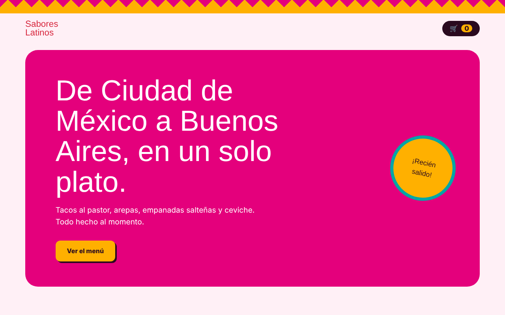
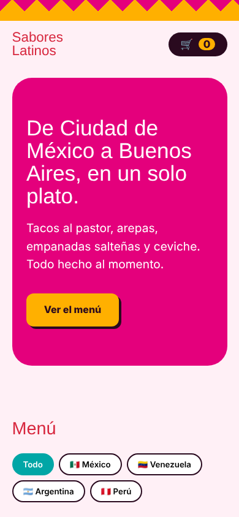

# Sabores Latinos

  

Landing de un restaurante de comida callejera latinoamericana con menú filtrable por país, carrito de pedido y reserva de mesa con validación.

**🔗 Demo en vivo:** https://rumenco1221.github.io/sabores-latinos/



## ✨ Funcionalidades

- Menú filtrable por país con pestañas
- Carrito lateral con contador animado y total en pesos
- Formulario de reserva con validación nativa y mensajes claros
- Decoración de papel picado hecha solo con CSS

## 🛠️ Tecnologías

- HTML5 semántico
- CSS3 (variables, Flexbox, Grid, animaciones, diseño responsive)
- JavaScript moderno (ES6+), sin frameworks ni librerías
- Fuentes de Google Fonts: Bowlby One + Work Sans

## 🧠 Lo que practiqué

- Delegación de eventos
- `reduce` para totales
- `toLocaleString` para formatear moneda
- Validación de formularios con `checkValidity()`
- Atributo `hidden` y accesibilidad (Escape cierra el panel)

## 🎨 Diseño

- **Paleta:** Magenta `#E4007C`, cempasúchil `#FFB000`, turquesa `#00A6A6`, chile `#D7263D`
- **Tipografía:** Bowlby One + Work Sans
- Responsive desde 360 px, foco visible con teclado y respeto por `prefers-reduced-motion`.



## 📁 Estructura

```
sabores-latinos/
├── index.html
├── assets/
│   ├── css/styles.css
│   └── js/main.js
├── docs/DOCUMENTACION.md
├── images/              # capturas
├── tests/               # pruebas automáticas
└── version_history/CHANGELOG.md
```

## ▶️ Cómo verlo

1. Descargá o cloná el repositorio: `git clone https://github.com/Rumenco1221/sabores-latinos.git`
2. Abrí `index.html` con doble clic, o usá la extensión **Live Server** de VS Code.

## ✅ Pruebas

Con Node.js instalado, desde la carpeta del proyecto:

```bash
node --test tests/test_estructura.mjs
```

Verifica SEO básico, semántica, accesibilidad de imágenes y que existan los archivos CSS y JS.

## 🚀 Próximas mejoras

- [ ] Guardar el pedido en localStorage
- [ ] Enviar el pedido por WhatsApp con un enlace `wa.me`
- [ ] Agregar opciones vegetarianas con filtro

## 👩‍💻 Autora

**Estela Oviedo Cortez** — Desarrolladora Full Stack en formación.
[LinkedIn](https://www.linkedin.com/in/estela-oviedo-cortez-796303228) · [GitHub](https://github.com/Rumenco1221)

## 📄 Licencia

MIT. Ver [LICENSE](LICENSE).
